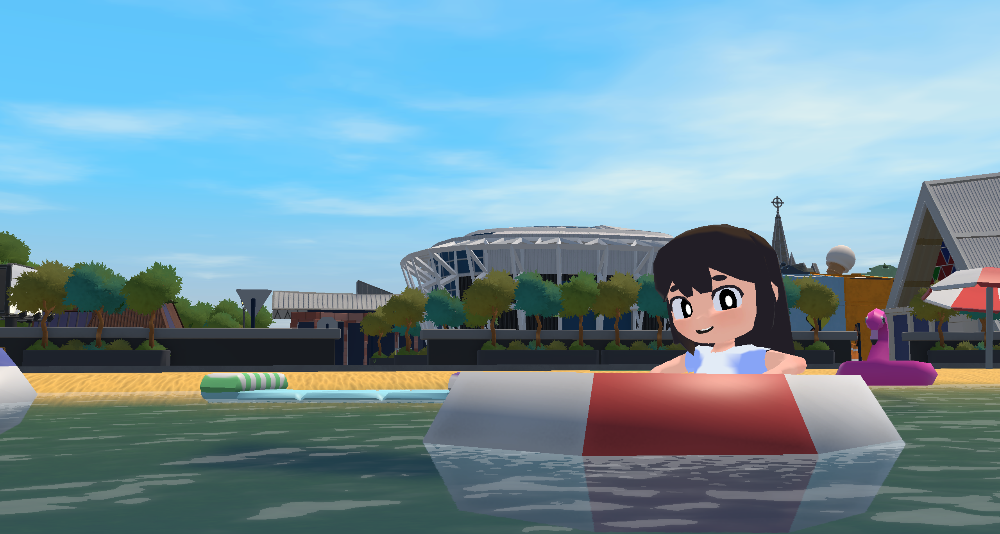

+++
date = '2026-09-24T12:24:15+12:00'
draft = false
title = 'Patchwork:Ōtautahi'
cover = 'baner.jpeg'
+++

## Trailer



## What is Patchwork Ōtautahi?

Patchwork Ōtautahi is an interactive mural spread across three screens at Tūranga, Christchurch's central library. It shows an isometric town modelled on Ōtautahi, full of little NPCs going about their day. Every so often one of them needs help deciding something, and anyone walking past can text them through a web app on their phone. When you help an NPC, they send you a selfie, and your choice stays visible in the town for everyone to see.

## My role

I was **lead designer and a programmer** on a team of 11. I built the NPC and task systems:

- **NPC AI:** navigation, zones, NPC sub-classes, schedules, and goal weighting.
- **Gameplay glue:** the SequenceHandler system, animations, the selfie feature, character customisation, and NPC reactions.
- **Game design:** coming up with the design and adapting it as problems came up.

**Team:** Caleb (web app and server), Sam K (content programming, UI), Danni (producer), Sam P (textures), Jams (3D models), Harold (level design), Kiven (NPC models, rigging and art lead), Max (animation), Shannon (VFX), Shanan (sound).

## Key takeaways

### 1. Use an interaction people already know

The main question behind the project was whether a familiar interaction like texting could make a public game easier to join. It did. we think these expenses could be made better buy using what people already know.

### 2. Test ideas you don't like

I didn't want character customisation at first. I thought it was copying for the sake of it. We tested it anyway. it turn out it helped people build a connection to the world, witch lead to more engagement with our core gameplay of the city. this helped achieve our goal so it was added as part of the game.

### 3. Impact needs a bit of imbalance

At first players' marks lasted all day, and the town quickly became cluttered. When every mark is loud, none of them stand out. We switched to marks that get overwritten, and did the same on the phone by showing fewer messages and highlighting one at a time.

### 4. Build rough and fast first

I spent early time predicting problems and solving them in advance. Most of those problems did show up, but solving them early wasn't worth it. Next time I'll build rough and fast, write down the problems, and fix them when we actually hit them.
I now very formally program in two phases. one where i quickly planning out and only doing good planning and coding on the thing I'm trying to make/test, and the rest can be crap as it will be done separately. Then, when it's where I want it and it works, I go back, replan—particularly how it will slot into the rest of the project—and then recode it.