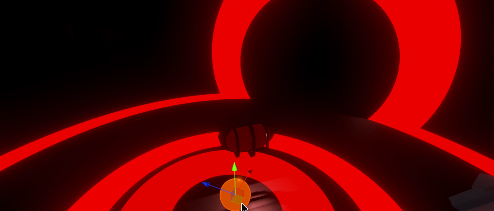

+++
date = '2026-09-24T12:24:15+12:00'
draft = false
title = 'Ripple Shader'
cover = 'RippleShaderBaner.jpeg'
+++

## What is my Ripple Shader?
This project was part of a horror project and I made this lighting effect with Unity Shader Graph to help light the world.

It was a fun time teaching myself shaders.

It uses actual points from the world to trigger these. I believe you are not supposed to do it this way but it works and I'm proud of it.

I would definitely do it much differently in the future.



![[RipleShaderGraph.jpeg|700]]

