+++
date = '2026-06-02T12:00:00+12:00'
draft = false
title = 'Unreal Level Design'
cover = 'tower-view.jpg'
+++

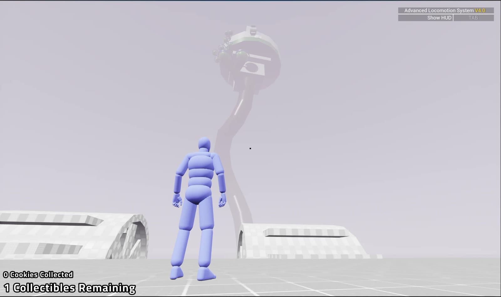

**Level design project · Unreal Engine · Advanced Locomotion System**

This is how I design levels. It's a vertical adventure level built in Unreal with the Advanced Locomotion System: you climb a giant Dr. Seuss-style tree tower through parkour, stealth, and bow sections.

## Planning

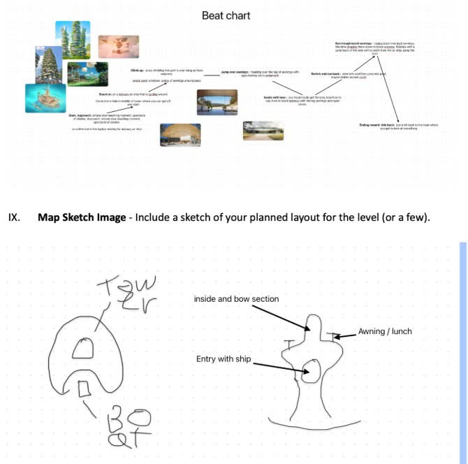

- I was given a macro chart with what I had to include.
- I then broke it down into a plan in my journal:
  - experience goals
  - the mechanics I wanted
  - the gameplay I wanted
  - laid it out into beats
  - mood boards / story
  - and rough sketches

## Block out

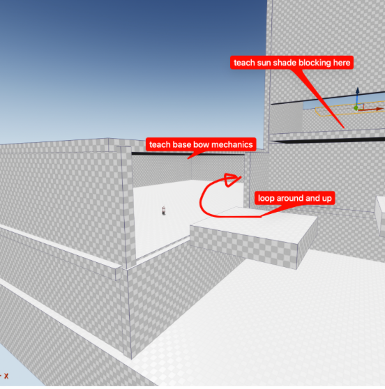

From these plans, after feedback, I started to block out the rough level.

The flow and intended path related to what I had written in the doc.

This let me get much more substantial feedback, while also starting to look at things like scale, scope, and framing.

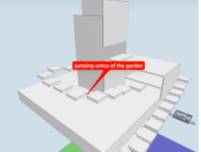

## Alpha

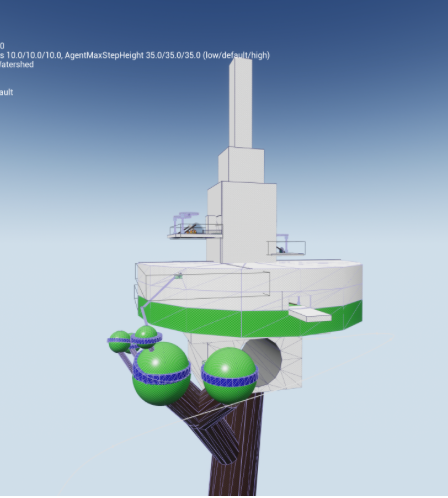

After the feedback from the block out, I was able to adjust a lot, changing weak parts and elevating the parts which worked.

## Scoping

I spent a bit of time cutting a lot this time. This map was just shrinking things down, as people found it too big and over-scoped. I simplified some of the goals so they could be added.

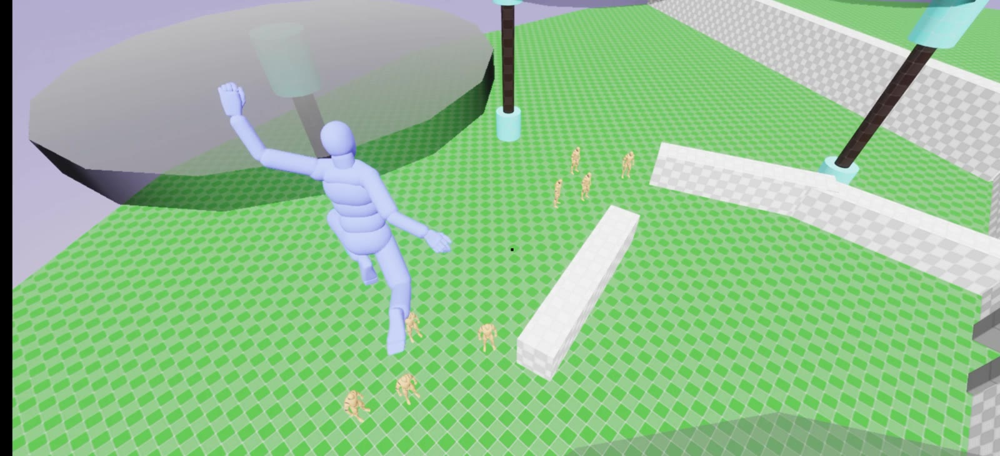

## Adding gameplay parts

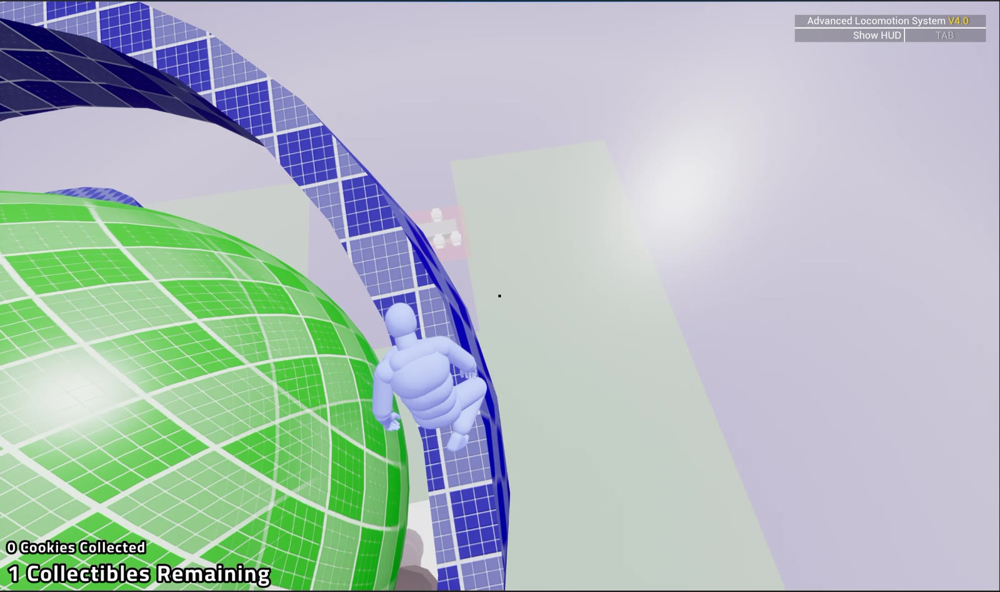

I changed it to have a Dr. Seuss feeling tree, as I reckon that fits the vibe more. I added a parkour section to the start, but I want to revisit it the most, as I really want the feeling of a sketchy high tower. To do this, I think I'll have the rings stick out from the balls so it's slower and safer, as well as giving you the framing of looking down at the big drop.

## Framing

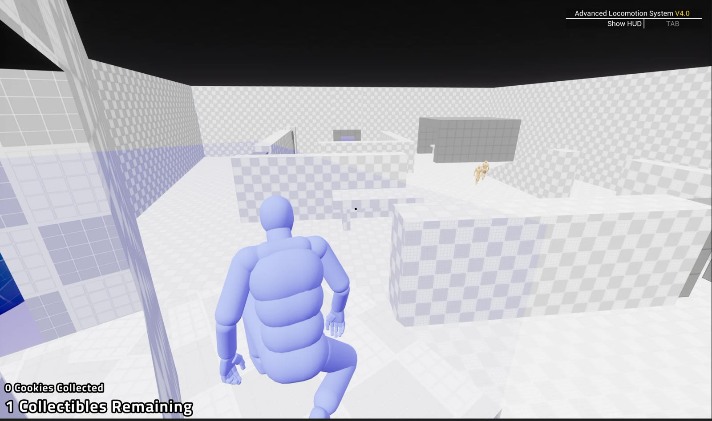

With this phase, I started focusing on the framing of everything. Like, are there leading lines and objects? Is the player looking at the things I want them to be?

Every room you came into you could see where to go, or the level forced the player to look down in the parkour and see the ground below.

I had you come into the first stealth room from a high spot so you can see the exit or goal.

Along these lines, I like the feeling of rising up from the bottom to the top.

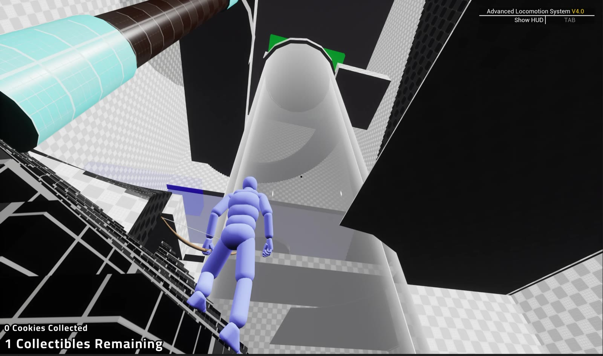

## Beta

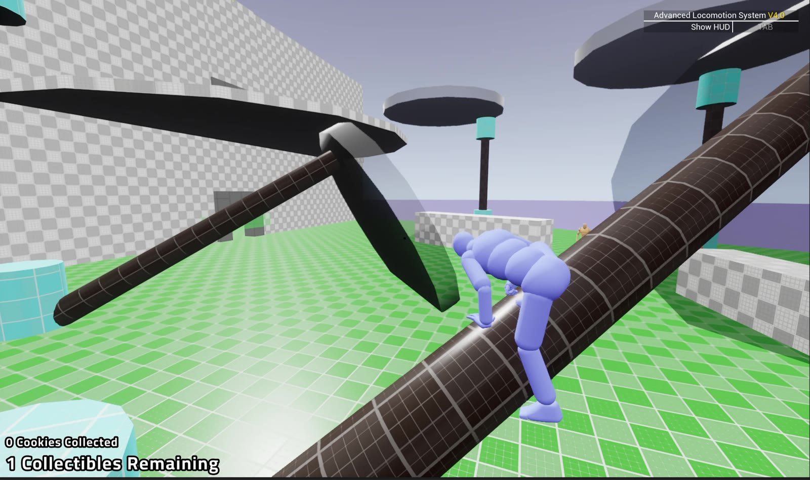

I changed the ride-up with a new drone model. I had to add fans at the front because everyone wanted to go inside, and it felt too safe. I added a few of these drones, so hopefully you don't miss them.

I changed the parkour section. This made the walkway way more sketchy, which I like. I added these spindly branches that are fun to explore and slowly go up. It also lets me remove my bad old stairs.

I added a spot to force you to go down a sunshade to get up the stairs. I just want to make sure they got taught this mechanic.

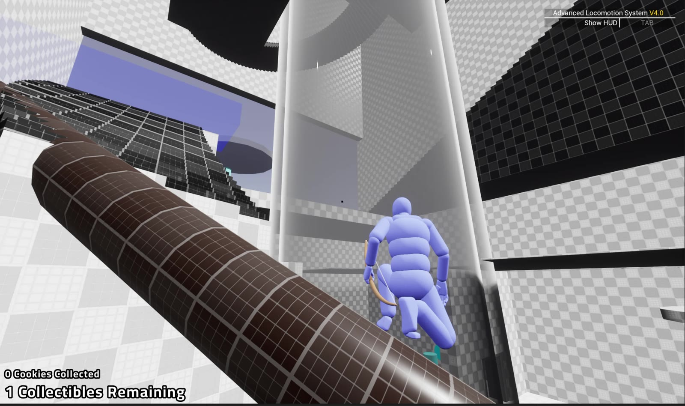

I've found overall that the set pieces of this level are neat. People like them, but the gameplay, or glue between them, is average. I believe this is an okay idea. I could fix it all, but I think it's a fundamental problem with how I planned out this level, focusing on the vibes rather than the gameplay.

In the future, I would try to plan them out in parallel, but through cutting and changing I have achieved what I wanted to, even if it's compromised or stuck together with parts I'm not proud of.

## Ending

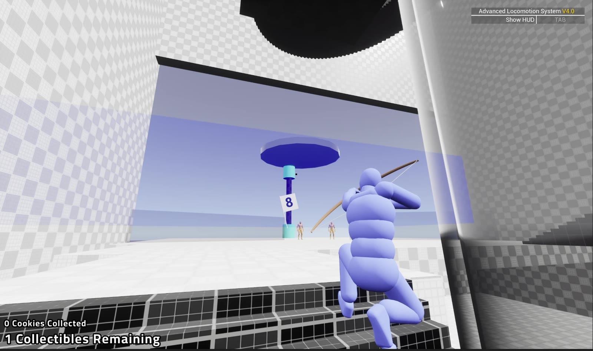

The other goal I had with the level was to target set pieces, as this is what I love about these types of adventure games. This had me thinking more about those beat paths and narrative ways of designing, with a lot more early planning.

This ended up working quite well, as people seem to respond to seeing the big tree, the elevator, or dropping the things. But it also ended up that the moment-to-moment gameplay was just average. I didn't design it as a whole, if that makes sense. It showed me how much how you plan something changes how something actually performs. The more I practice these different organisational patterns or team structures, the more I see it's not just about how efficiently something is made, but also what is made. I believe this is interesting, and being able to try three different ways of designing, partly with this last one, has helped me understand this better.

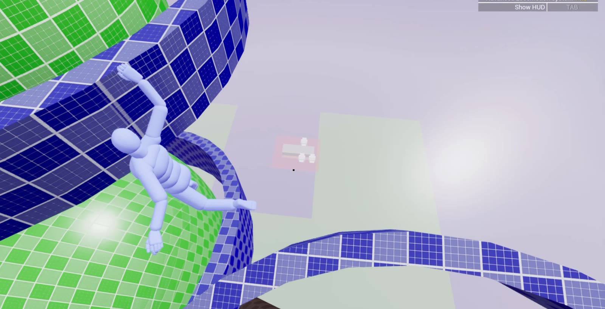
